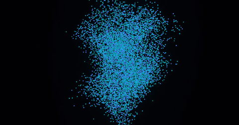
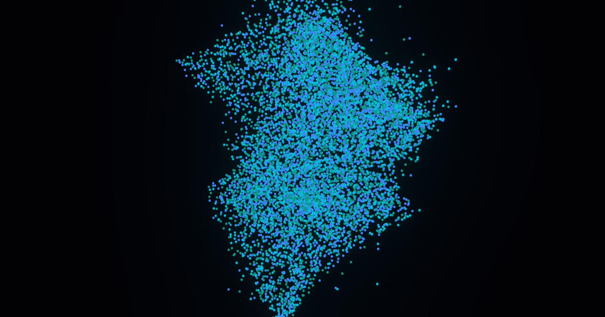
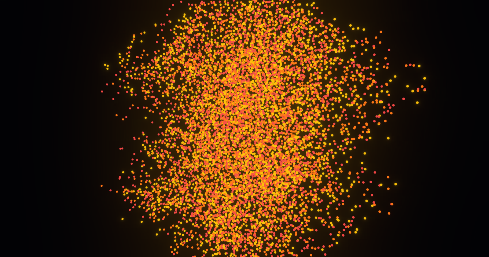

# Fluid Figures



A meditative 10,000-particle countdown built with Three.js. Watch ten thousand points of light form numbers, dissolve, and reform — cooling from indigo to white-hot amber as time runs down. At zero, everything collapses to a single point and fades to silence.



## Try It

```bash
git clone https://github.com/AndrewVoirol/ais-fluid-figures-3d-wedgl-particle-practice.git
cd ais-fluid-figures-3d-wedgl-particle-practice
npm install
npm run dev
```

Opens at `http://localhost:3000`

## How It Works

**Hold** your cursor to attract particles. **Release** to let them snap back. The countdown runs itself — 10 down to 0, each number scattered into the next. Colors shift from cool indigo through teal and amber to white-hot as zero approaches. The camera slowly drifts closer.

At zero, all 10,000 particles converge to a single bright point, bloom intensifies, and the screen fades to black. Click anywhere to go again.

Under the hood: 10,000 instanced spheres with per-frame CPU physics — spring forces, friction, noise displacement, and mouse-driven gravity wells. Each particle lerps independently between color palettes as the countdown phase changes. Bloom post-processing from `@react-three/postprocessing` creates the glow.



## Tech Stack

| Layer | Technology |
|---|---|
| Framework | React 19 + Vite 6 |
| 3D Engine | Three.js via `@react-three/fiber` |
| Post-processing | `@react-three/postprocessing` (Bloom) |
| Language | TypeScript |
| Styling | Vanilla CSS |

## Origin

Prototyped in [Google AI Studio](https://aistudio.google.com), exported, rebuilt as a standalone art piece. Part of a broader gallery of AI Studio experiments brought local and pushed to GitHub.

---

*No audio. Pair with your own ambient soundtrack.*
